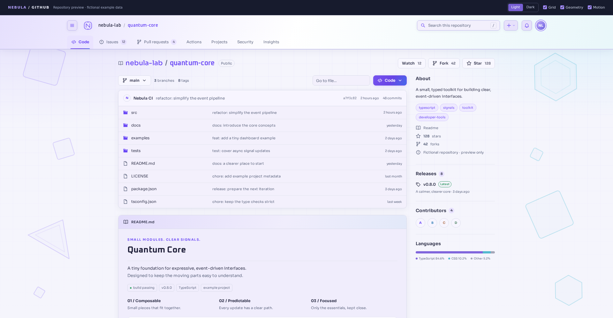
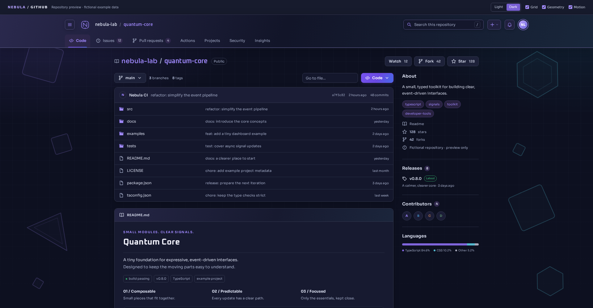
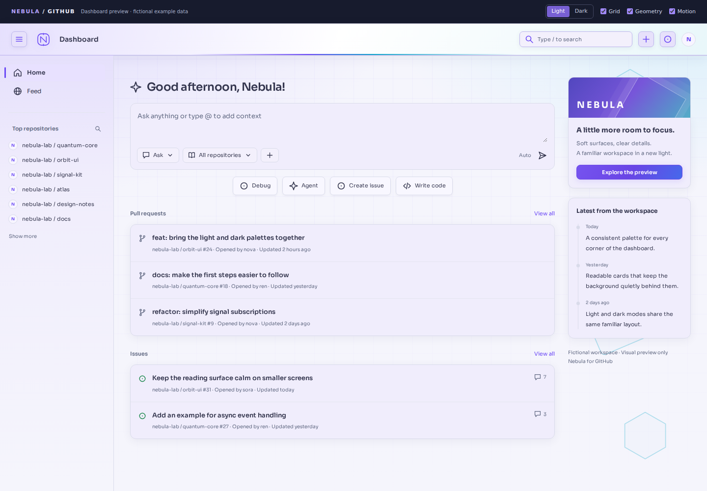
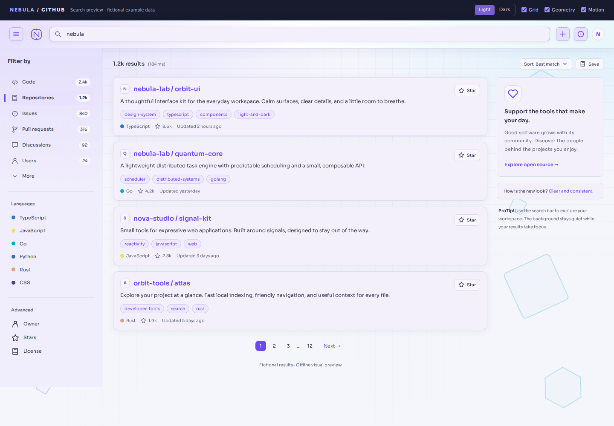

# Nebula for GitHub

A soft violet light theme and a deep navy dark theme for GitHub, with subtle gradients, fine grids, and floating geometric accents.

**[Install with Stylus](https://raw.githubusercontent.com/saladinxp/github-nebula-theme/main/dist/nebula-github.user.css)** · **[Download ZIP](https://github.com/saladinxp/github-nebula-theme/releases/download/v1.2.1/nebula-github-1.2.1.zip)** · [中文说明](README.zh-CN.md) · [Changelog](CHANGELOG.md) · [Gitea edition](https://github.com/saladinxp/gitea-nebula-theme)

## Download, install, and update

| What you need | Link / action |
| --- | --- |
| Current complete package (v1.2.1) | **[Download nebula-github-1.2.1.zip](https://github.com/saladinxp/github-nebula-theme/releases/download/v1.2.1/nebula-github-1.2.1.zip)** |
| All releases / future downloads | [Latest release](https://github.com/saladinxp/github-nebula-theme/releases/latest) · [Release history](https://github.com/saladinxp/github-nebula-theme/releases) |
| Verify the ZIP and standalone files | [SHA-256 checksums](https://github.com/saladinxp/github-nebula-theme/releases/download/v1.2.1/release-SHA256SUMS.txt) |
| First install in the browser | **[Install UserCSS with Stylus](https://raw.githubusercontent.com/saladinxp/github-nebula-theme/main/dist/nebula-github.user.css)** · [Installation steps](#install) |
| Update an installed style | Stylus → Manage → Check for updates; [details](#update-or-remove) |

The complete ZIP includes installation instructions, optional fonts, offline previews, source files, and licenses. Extract it first. GitHub's automatically generated **Source code** archives are repository snapshots; use the named ZIP above for the prepared package.

## Preview

| Light | Dark |
| --- | --- |
|  |  |

Previews use fictional repositories and authored example pages.

## Features

- Light and dark palettes follow GitHub's appearance setting.
- Coordinated navigation, repository files, README, dashboard, and search surfaces.
- Opaque reading cards and sidebars keep decoration behind the content.
- Independent grid, geometry, and animation controls.
- CSS only: no added JavaScript, remote images, or remote font requests.
- Native status, warning, error, syntax, and diff colors retain their roles.
- System reduced-motion and forced-color preferences are respected.

## Install

1. Install **Stylus** for [Chrome / Edge](https://chromewebstore.google.com/detail/stylus/clngdbkpkpeebahjckkjfobafhncgmne) or [Firefox](https://addons.mozilla.org/firefox/addon/styl-us/).
2. Open **[nebula-github.user.css](https://raw.githubusercontent.com/saladinxp/github-nebula-theme/main/dist/nebula-github.user.css)** and choose **Install style**.
3. Refresh GitHub.

Choose a light theme, a dark theme, or system synchronization in GitHub **Settings → Appearance**. Nebula follows that choice.

The theme applies to `https://github.com/` in the browser where you install it. It does not modify repository files or other visitors' pages.

### Where is the color switch?

Open **[GitHub Settings → Appearance](https://github.com/settings/appearance)** and choose **Light**, **Dark**, or **Sync with system**. Nebula follows GitHub's setting. Its Stylus options control the grid, geometry, and motion; they do not add a separate color selector to GitHub's header.

The Light / Dark buttons at the top of the offline demo are **preview controls only**. The demo uses sample markup and bundled fonts, so its header layout and typography may differ from the live site. Install the optional fonts below to use the same font families locally.

### Update or remove

Install from the Raw link above to give Stylus a permanent update source. If your copy was installed from a downloaded file or pasted CSS, open that link once and replace the existing Nebula style. Keep only one enabled copy.

For later releases, use **Check for updates** in Stylus. Manually managed styles can also be updated by replacing their complete UserCSS and saving. To disable or remove Nebula, use its switch or delete action in Stylus.

[Official Stylus installation guide](https://github.com/openstyles/stylus/wiki/Writing-UserCSS#installation)

## Options

Open the theme's gear icon in Stylus.

| Setting | Default | Effect |
| --- | --- | --- |
| Fine grid / 细网格背景 | On | Show or hide the grid. |
| Floating geometry / 漂浮几何背景 | On | Show or hide the outlined shapes. |
| Background and header motion / 背景与顶栏动效 | On | Run or pause the geometric drift and header highlight. |

The grid and broad glow stay stationary. Two decorative layers move with 18- and 22-second desktop cycles; narrow layouts use 32 seconds. They do not receive clicks or change page dimensions. Reduced-motion preferences stop animation, and printing hides the shapes.

## Optional fonts

Nebula uses locally installed **Sora**, **Oxanium**, and **JetBrains Mono**, with system-font fallbacks. The three unmodified `.ttf` files in [`fonts/`](fonts/) are optional. Chinese and other scripts use system fonts.

The offline previews embed bundled WOFF2 fonts. The installed UserCSS does not download or embed fonts.

## More previews

| Dashboard | Search |
| --- | --- |
|  |  |

Download an HTML preview and open it locally to try its color and background controls:

- [Repository preview](preview/nebula-github-preview.html)
- [Dashboard preview](preview/nebula-github-dashboard-preview.html)
- [Search preview](preview/nebula-github-search-preview.html)

These are independent examples, not live GitHub pages.

## Build from source

Requires Python 3, without third-party build dependencies.

```sh
python3 build-theme.py
```

The build writes both CSS variants and the three standalone previews. The SVG geometry masks are embedded directly into the CSS.

To build the ZIP and checksums:

```sh
python3 package-theme.py
```

Output: `release/nebula-github-1.2.1.zip`.

## Compatibility and feedback

GitHub changes its markup and rolls out different page variants. New variants may need adjustments. Report the page type, color mode, and browser version in [Issues](https://github.com/saladinxp/github-nebula-theme/issues).

The styles preserve native layout and scrolling. They do not alter image pixels; white inside an image remains part of that image. Disabling the style restores GitHub's original appearance.

This project is independent of GitHub. Self-hosted Gitea uses the separate [Gitea edition](https://github.com/saladinxp/gitea-nebula-theme).

## Attribution and licensing

See [LICENSING.md](LICENSING.md), [NOTICE.txt](NOTICE.txt), and the bundled font licenses. Font licenses apply to the fonts, not to the entire theme.

